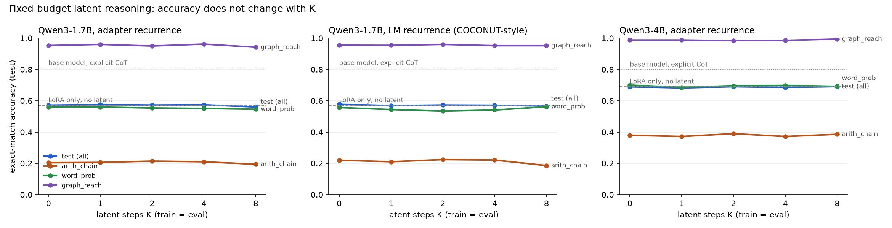
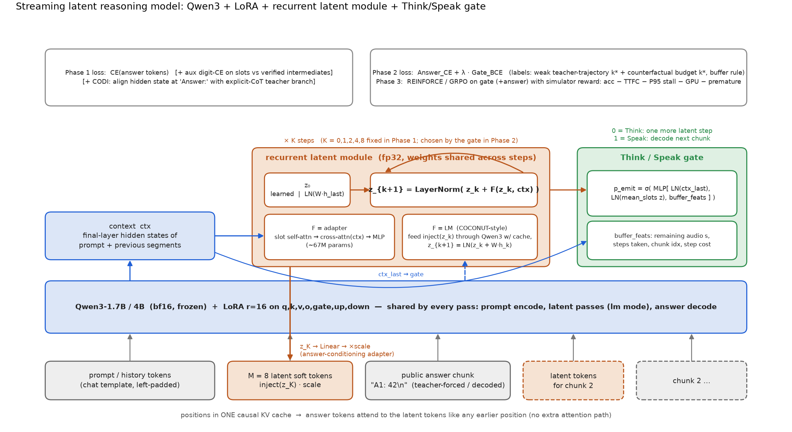

# Report: does recurrent latent reasoning help Qwen3? (Phase 1, first deliverable)

> Part 2 (readable Think/Speak model with last-layer MoE router, trained on K&K + MuSiQue and evaluated under the SxS protocol) is in [REPORT_PART2.md](REPORT_PART2.md).

Date: 2026-11-03. Hardware: A100-80GB (p41, p4). Code: this repo (`latent/`), tests in `tests/` (13/13 pass).

## TL;DR

**No.** Under matched training budget, identical data and identical public output length, recurrent latent computation
gave **no measurable accuracy benefit** at any K in {0, 1, 2, 4, 8}, for Qwen3-1.7B and Qwen3-4B, for two recurrence
designs (small adapter F; LM-as-F, COCONUT-style) and five remedies (context-initialised state, mid-layer context, CODI
self-distillation, verified intermediate-result supervision, latent-only training). Every variant lands within seed noise
(about +-0.8 pt) of a LoRA-only direct-answer baseline (57.1% on 1.7B, 69.1% on 4B). The same base model with explicit CoT
reaches 80.9% (1.7B) and 79.9% (4B), so the tasks have real headroom that the latent path does not capture.

Diagnostics explain the null result: (i) with the adapter design the latent state is context independent (across-example
std 0.0007); the LM uses the 8 soft tokens only as a learned prefix (zeroing them -> 0% accuracy, shuffling
them across examples -> no change). (ii) When the state is forced to be context dependent by supervising the slots with
verified intermediate results, the adapter decodes the first intermediate at 23% and the final answer at 4.5%: it cannot learn
the computation. (iii) With LM-as-F recurrence the LM does depend on the latent positions (evaluating at K=0 collapses to 44%),
but shuffling z across examples still changes nothing (0.585 -> 0.592): the extra passes add positions, not reasoning.

Per the plan's hard prerequisite, **Phase 2 (BCE gate) and Phase 3 (RL) were not trained as experiments.** Their code is
implemented, unit-tested and smoke-validated end-to-end at reduced scale (see "Pipeline validation"), so they can be run the
moment a latent design clears Phase 1.

## 1. What was built

| component | file | notes |
|---|---|---|
| Recurrent latent module | `latent/model.py: LatentModule` | M=8 slots, `z_(k+1) = LayerNorm(z_k + F(z_k, ctx))`, shared weights, step embedding. Two F's: **adapter** (slot self-attn + cross-attn to context hidden states + MLP, 67M params fp32) and **lm** (F = Qwen3 itself: latent tokens are fed through the LM with the KV cache, `z_(k+1) = LN(z_k + W h_k)`). Init options: learned `z_0` or `z_0 = LN(W h_last)` from the prompt's final hidden state. |
| Answer-conditioning adapter | `LatentReasoner.latent_tokens` | z -> Linear -> 8 soft input embeddings between context and answer, scaled to embedding RMS; answer attends to them through the ordinary causal KV cache. K=0 injects `z_0` (same tokens, no computation). |
| Think/Speak gate | `GateHead` | `sigmoid(MLP([LN(ctx_last), LN(mean z), buffer feats]))`, buffer feats = remaining audio, steps taken, chunk index, per-step cost. |
| Chunked (multi-segment) forward + streaming decoder | `forward_chunked`, `stream_chunked` | per-chunk latent budgets, latent state carried across chunks, gate logits at every decision point, batch-1 streaming with timed think/speak events. |
| Tests | `tests/test_model.py`, `tests/test_rl.py` | gradients reach latent module and LoRA (base frozen); latents change logits; causal mask (no leak from future answer tokens, prompt states independent of latents); left-padding invariance; **KV-cache incremental decoding == teacher-forced argmax** (both recurrence modes); chunk-level causality; gate gradients; RL rollout -> recompute path. |
| Data | `latent/data.py` | self-generated, programmatically verified: `arith_chain` (3-5 ops), `word_prob` (2-4 step templated stories), `graph_reach` (ProsQA-style DAG yes/no, path >= 2, balanced); held-out `even_sum` (unseen family) and `arith_chain_deep` (6-7 ops); multi-question "chunked" prompts for Phase 2. 24k train / 900 val / 1.5k test / 1k held-out. |
| Phase 1 trainer/eval | `latent/train_fixed_k.py` | fixed-K training, eval at other K, CODI self-distillation, aux intermediate supervision, timing. |
| Baselines | `latent/baselines.py` | base model direct answer (no thinking) and full explicit CoT (thinking mode). |
| Phase 2/3/4 | `chunked.py`, `label_counterfactual.py`, `train_chunked.py`, `rl_gate.py`, `simulator.py`, `eval_streaming.py` | weak teacher labels + counterfactual budget labels, buffer-aware Think/Speak labels, `Answer_CE + lambda*Gate_BCE`, custom batched rollouts with GRPO-style advantages and simulator reward (accuracy, TTFC, P95 stall, GPU time, premature statements), text-only playback simulator, policy evaluation (gate / fixed-k / STITCH-like / oracle). |

Training protocol for every Phase 1 cell: LoRA r=16 (alpha 32) on q,k,v,o,gate,up,down; latent module full fp32; AdamW,
lr 2e-4 (LoRA) / 3e-4 (latent), 50 warm-up, cosine; 1500 steps x 32 examples (2 epochs); bf16 base; greedy decoding of
`Answer: <value>` (<= 12 tokens); exact match after normalisation. Public output is identical across K by construction.

## 2. Phase 1 results

### 2.1 Qwen3-1.7B (test exact match; `arith`, `word`, `graph` = per task; `heldout` = unseen family + unseen depth)

Run naming: `K<k>` adapter recurrence trained and evaluated with k steps; `lora_only` = no latent tokens; `zlast` = context-initialised
`z_0`; `K4mid` = context from layer -10; `*aux` = + verified intermediate-result supervision on the slots; `K4codi` = CODI
self-distillation from an explicit-CoT teacher branch; `latonly` = latent module only, LoRA frozen; `lm_*` = LM-as-F recurrence;
`_s1` = second seed.

| run | train K | test acc | arith_chain | word_prob | graph_reach | heldout acc | even_sum | arith_deep | ms/ex | latent ms/ex | train min |
|---|---|---|---|---|---|---|---|---|---|---|---|
| K0_s0 | 0 | 0.575 | 0.196 | 0.572 | 0.958 | 0.019 | 0.000 | 0.038 | 18.0 | 3.13 | 22.1 |
| K0_s1 | 0 | 0.569 | 0.212 | 0.546 | 0.948 | 0.015 | 0.000 | 0.030 | 18.2 | 3.11 | 22.9 |
| K1_s0 | 1 | 0.575 | 0.206 | 0.560 | 0.960 | 0.019 | 0.002 | 0.036 | 18.1 | 3.40 | 22.7 |
| K1aux_s0 | 1 | 0.547 | 0.196 | 0.516 | 0.928 | 0.011 | 0.002 | 0.020 | 18.5 | 3.41 | 23.6 |
| K2_s0 | 2 | 0.573 | 0.214 | 0.554 | 0.950 | 0.018 | 0.000 | 0.036 | 18.3 | 3.69 | 23.3 |
| K4_s0 | 4 | 0.573 | 0.206 | 0.552 | 0.962 | 0.018 | 0.000 | 0.036 | 19.3 | 4.26 | 25.0 |
| K4_s1 | 4 | 0.575 | 0.214 | 0.550 | 0.962 | 0.018 | 0.000 | 0.036 | 19.1 | 4.25 | 25.5 |
| K4aux_s0 | 4 | 0.547 | 0.190 | 0.498 | 0.952 | 0.007 | 0.000 | 0.014 | 18.9 | 4.26 | 25.5 |
| K4codi_s0 | 4 | 0.561 | 0.202 | 0.524 | 0.956 | 0.015 | 0.000 | 0.030 | 19.1 | 4.25 | 58.5 |
| K4mid_s0 | 4 | 0.573 | 0.208 | 0.552 | 0.958 | 0.012 | 0.000 | 0.024 | 18.9 | 4.27 | 25.6 |
| K8_s0 | 8 | 0.561 | 0.194 | 0.546 | 0.942 | 0.018 | 0.000 | 0.036 | 20.6 | 5.40 | 28.0 |
| K8aux_s0 | 8 | 0.554 | 0.198 | 0.520 | 0.944 | 0.017 | 0.002 | 0.032 | 20.1 | 5.41 | 28.4 |
| latonly_K0_s0 | 0 | 0.304 | 0.026 | 0.118 | 0.768 | 0.004 | 0.006 | 0.002 | 21.5 | 7.18 | 12.6 |
| latonly_K4_s0 | 4 | 0.305 | 0.028 | 0.120 | 0.766 | 0.005 | 0.010 | 0.000 | 23.5 | 9.41 | 18.7 |
| lm_K0_s0 | 0 | 0.579 | 0.224 | 0.560 | 0.954 | 0.013 | 0.000 | 0.026 | 18.1 | 3.12 | 22.5 |
| lm_K0_s1 | 0 | 0.575 | 0.216 | 0.554 | 0.956 | 0.015 | 0.000 | 0.030 | 18.0 | 3.11 | 22.7 |
| lm_K1_s0 | 1 | 0.569 | 0.210 | 0.544 | 0.954 | 0.019 | 0.000 | 0.038 | 19.0 | 4.22 | 27.4 |
| lm_K2_s0 | 2 | 0.573 | 0.224 | 0.534 | 0.960 | 0.013 | 0.000 | 0.026 | 19.8 | 5.34 | 32.3 |
| lm_K4_s0 | 4 | 0.563 | 0.216 | 0.526 | 0.948 | 0.011 | 0.000 | 0.022 | 22.1 | 7.62 | 44.6 |
| lm_K4_s1 | 4 | 0.579 | 0.226 | 0.556 | 0.956 | 0.018 | 0.000 | 0.036 | 22.3 | 7.62 | 43.0 |
| lm_K8_s0 | 8 | 0.567 | 0.186 | 0.562 | 0.952 | 0.015 | 0.000 | 0.030 | 26.9 | 12.34 | 62.3 |
| lm_zlast_K4_s0 | 4 | 0.570 | 0.216 | 0.544 | 0.950 | 0.017 | 0.002 | 0.032 | 22.5 | 7.62 | 43.5 |
| lora_only_s0 | 0 | 0.571 | 0.216 | 0.542 | 0.956 | 0.013 | 0.000 | 0.026 | 16.5 | 0.00 | 21.9 |
| zlast_K0_s0 | 0 | 0.579 | 0.216 | 0.570 | 0.952 | 0.018 | 0.002 | 0.034 | 17.8 | 3.12 | 30.6 |
| zlast_K4_s0 | 4 | 0.575 | 0.222 | 0.550 | 0.952 | 0.012 | 0.000 | 0.024 | 19.2 | 4.27 | 36.7 |

Seed noise: K0 0.575/0.569, K4 0.573/0.575, lm_K0 0.579/0.575, lm_K4 0.563/0.579 -> about +-0.8 pt. No K effect exceeds it.

Base model, no LoRA: direct answer **27.1%** (graph 72.6, arith 1.2, word 7.4); explicit CoT **80.9%** (arith 99.4, word 82.0,
graph 61.4; 835 generated tokens, 1.8 s/example vs 18-27 ms/example for the latent models). Held-out: direct 0.8%, CoT 97.7%.
Held-out accuracy of every trained variant is 0-2% (even_sum 0%): nothing transfers to an unseen task family or depth.

Test-time budget transfer (train at K, evaluate at K'):

| run \ eval K | 0 | 1 | 2 | 4 | 8 |
|---|---|---|---|---|---|
| K0_s0 | 0.575 | 0.572 | 0.573 | 0.569 | 0.573 |
| K0_s1 | 0.569 | - | - | 0.566 | - |
| K1_s0 | 0.567 | 0.575 | 0.567 | 0.571 | 0.569 |
| K1aux_s0 | 0.541 | 0.547 | 0.545 | 0.539 | 0.535 |
| K2_s0 | 0.568 | 0.573 | 0.573 | 0.570 | 0.570 |
| K4_s0 | 0.570 | 0.575 | 0.571 | 0.573 | 0.575 |
| K4_s1 | 0.543 | - | - | 0.575 | - |
| K4aux_s0 | 0.379 | 0.546 | 0.548 | 0.547 | 0.545 |
| K4codi_s0 | 0.570 | 0.561 | 0.560 | 0.561 | 0.565 |
| K4mid_s0 | 0.563 | 0.581 | 0.579 | 0.573 | 0.575 |
| K8_s0 | 0.561 | 0.559 | 0.558 | 0.557 | 0.561 |
| K8aux_s0 | 0.545 | 0.553 | 0.554 | 0.551 | 0.554 |
| latonly_K0_s0 | 0.304 | 0.307 | 0.304 | 0.303 | 0.306 |
| latonly_K4_s0 | 0.001 | 0.006 | 0.298 | 0.305 | 0.301 |
| lm_K0_s0 | 0.579 | 0.572 | 0.565 | 0.556 | 0.258 |
| lm_K0_s1 | 0.575 | - | - | 0.249 | - |
| lm_K1_s0 | 0.565 | 0.569 | 0.565 | 0.569 | 0.564 |
| lm_K2_s0 | 0.000 | 0.560 | 0.573 | 0.571 | 0.573 |
| lm_K4_s0 | 0.437 | 0.549 | 0.557 | 0.563 | 0.551 |
| lm_K4_s1 | 0.009 | - | - | 0.579 | - |
| lm_K8_s0 | 0.116 | 0.561 | 0.563 | 0.567 | 0.567 |
| lm_zlast_K4_s0 | 0.271 | 0.555 | 0.559 | 0.570 | 0.566 |
| zlast_K0_s0 | 0.579 | 0.579 | 0.583 | 0.582 | 0.581 |
| zlast_K4_s0 | 0.577 | 0.576 | 0.575 | 0.575 | 0.575 |

Reading: adapter models are completely insensitive to K' (the latent content is a constant). `K4aux`, `lm_K*`, `lm_zlast`
drop sharply at K'=0 because the LM has learned to expect the extra positions / a context-dependent token, not because those
positions carry reasoning (see diagnostics).

### 2.2 Qwen3-4B (adapter recurrence)

| run | train K | test acc | arith_chain | word_prob | graph_reach | heldout acc | even_sum | arith_deep | ms/ex | latent ms/ex | train min |
|---|---|---|---|---|---|---|---|---|---|---|---|
| K0_s0 | 0 | 0.689 | 0.380 | 0.700 | 0.988 | 0.052 | 0.020 | 0.084 | 29.5 | 4.89 | 46.6 |
| K1_s0 | 1 | 0.682 | 0.372 | 0.686 | 0.988 | 0.044 | 0.010 | 0.078 | 30.3 | 5.35 | 48.3 |
| K2_s0 | 2 | 0.690 | 0.390 | 0.696 | 0.984 | 0.056 | 0.018 | 0.094 | 30.4 | 5.77 | 48.9 |
| K4_s0 | 4 | 0.685 | 0.372 | 0.698 | 0.986 | 0.052 | 0.022 | 0.082 | 34.1 | 6.63 | 51.7 |
| K8_s0 | 8 | 0.691 | 0.386 | 0.692 | 0.994 | 0.048 | 0.016 | 0.080 | 32.7 | 8.35 | 55.6 |
| lora_only_s0 | 0 | 0.691 | 0.386 | 0.704 | 0.982 | 0.057 | 0.018 | 0.096 | 27.8 | 0.00 | 46.8 |

| run \ eval K | 0 | 1 | 2 | 4 | 8 |
|---|---|---|---|---|---|
| K0_s0 | 0.689 | 0.691 | 0.689 | 0.687 | 0.688 |
| K1_s0 | 0.684 | 0.682 | 0.683 | 0.685 | 0.683 |
| K2_s0 | 0.391 | 0.687 | 0.690 | 0.689 | 0.689 |
| K4_s0 | 0.683 | 0.683 | 0.688 | 0.685 | 0.683 |
| K8_s0 | 0.685 | 0.689 | 0.690 | 0.693 | 0.691 |

Base Qwen3-4B, no LoRA: direct answer **27.1%** (graph 64.0, arith 5.8, word 11.6); explicit CoT **79.9%** (arith 100.0, word 91.0, graph 48.8; 829 generated tokens, 3444 ms/example vs 28-34 ms for the latent models).
Same picture as 1.7B: K0..K8 and lora_only all at 68.2-69.1%, i.e. 11 points below explicit CoT at 1/100 of the decode cost, and no K dependence.

### 2.3 Diagnostics (`latent/diag_latent.py`, 600 test examples)

| probe | adapter K4 | adapter K4 + aux | LM-as-F K4 |
|---|---|---|---|
| normal (own z_K) | 0.593 | 0.565 | 0.585 |
| z shuffled across examples | 0.598 | 0.555 | 0.592 |
| z = z_0 (K=0 path) | 0.585 | 0.373 | 0.453 |
| latent tokens zeroed | 0.000 | 0.520 | 0.000 |
| z = Gaussian noise | 0.238 | 0.227 | 0.092 |
| across-example std of z_K | 0.0007 | 0.380 | 0.011 |
| step deltas ‖z_(k+1)-z_k‖ | 61.1, 2.0, 0.1, 0.0 | 61.3, 12.0, 3.8, 2.4 | 47.2, 16.9, 4.8, 2.2 |

- **Adapter**: z is context independent and the recurrence hits a fixed point after 2 steps (deltas 61 -> 2 -> 0.06 -> 0.02).
  The LM relies on the tokens (zeroing destroys the output format) but only as a learned prefix: a prefix-tuning head.
- **Adapter + aux supervision**: the slots now vary with the input (std 0.38) and the aux digit heads decode the 1st
  intermediate at 23%, 2nd at 17%, 3rd at 3%, final answer at 4.5% (aux loss plateaued at 4.6 nats).
  A single cross-attention + MLP block does not learn multi-step integer arithmetic from 48k examples; the LM is right to ignore it.
- **Latent-only** (LoRA frozen): 30% at K=0 and K=4, i.e. the soft-token channel alone barely steers the frozen LM.
- **LM-as-F**: the latents are consumed (K'=0 collapses), but shuffling z across examples does not hurt. The extra LM passes
  behave like extra "pause" positions; with answer-only supervision nothing forces them to carry per-example computation.
- **CODI** (hidden-state alignment to an explicit-CoT teacher branch, same LoRA): teacher CoT CE fell to 0.01 and the
  alignment loss to 0.006, yet student accuracy stayed at 56.1%. The student matches the teacher's hidden state at the
  "Answer:" position without acquiring the computation that produced it.

## 3. Compute

| | adapter latent step | LM-as-F latent step | answer generation | explicit CoT |
|---|---|---|---|---|
| 1.7B, per example (A100, bs 64) | ~0.3-0.6 ms | ~1.1 ms (8 tokens through the LM, cached) | 17-27 ms | 1789 ms |
| 4B, per example | ~0.4-0.9 ms | - | 28-34 ms | 3444 ms |

Training: 22-28 min per 1.7B cell (adapter), 27-62 min (LM-as-F, grows with K), 47-56 min per 4B cell (bs 16 x 2 accumulation), CODI 58 min.
Total Phase 1 compute: 31 cells, ~17 GPU-hours.

## 4. Pipeline validation for Phases 2-4 (mechanism only, not a result)

Run once at reduced scale on Qwen3-1.7B to verify the Phase 2/3/4 code paths on a real model (stage A 300 steps,
counterfactual labels on 600 train / 100 test prompts, gate stages 200 steps each, 100 test prompts streamed, 20 RL steps,
simulated per-step cost 0.2 s, TTS model 0.35 s/word). **These numbers validate mechanism, not the hypothesis**; with no
K-dependence there is nothing for the gate to exploit, and the training budgets are tiny.

- **Counterfactual budget experiment** (`label_counterfactual.py`, chunk correctness vs k with ground-truth previous chunks):
  easy 1.00 at every k; arith_chain 0.07-0.08; word_prob 0.28-0.30; graph_reach 0.84-0.86 -> flat in k, consistent with Phase 1.
  Labels therefore fall back to the weak teacher-trajectory labels (easy -> speak at once; others -> think k* = number of
  reasoning steps), combined with the buffer rule.
- **Gate training** (`Loss = Answer_CE + 1.0 * Gate_BCE`): decision accuracy 83-94%; label Speak fraction 0.41-0.50 and predicted
  0.31-0.44 -> both classes learned, no collapse. Learned behaviour on the test stream: p_emit = 1.00 for easy sub-questions at
  j=0; 0.39-0.50 at j=0 and 0.04-0.17 at j=1-3 for hard sub-questions, rising to 0.62-0.76 at j=4 (the weak label); the
  buffer-aware gate emits more readily when the audio buffer is empty (mean p_emit 0.51) than when > 0.5 s is buffered (0.36).
- **Streaming evaluation** (100 prompts, 2-4 sub-questions each; `eval_streaming.py` + `simulator.py`):

| policy | chunk acc | all-correct | TTFC (s) | P50 / P95 pause (s) | GPU s | hidden steps | mean k | premature rate |
|---|---|---|---|---|---|---|---|---|
| fixed k=4 every chunk (baseline 3 / STITCH-like budget) | 0.657 | 0.24 | 1.32 | 0.42 / 0.48 | 3.81 | 13.0 | 4.0 | 0.343 |
| BCE gate, no buffer awareness (baseline 6) | 0.670 | 0.28 | 1.01 | 0.00 / 1.11 | 2.90 | 8.4 | 2.5 | 0.330 |
| BCE gate, buffer-aware (baseline 7) | 0.667 | 0.27 | 0.53 | 0.00 / 1.22 | 2.50 | 6.4 | 1.8 | 0.333 |
| oracle k* (weak+counterfactual labels) | 0.653 | 0.24 | 0.84 | 0.00 / 0.47 | 2.18 | 4.9 | 1.3 | 0.347 |

  The gates cut time-to-first-content (1.32 -> 0.53 s) and GPU time by thinking only before hard chunks; accuracy is unchanged
  because, per Phase 1, thinking does not change answers. The buffer-aware gate's higher P95 pause (it still thinks 3 steps on
  hard chunks when the buffer is empty) is the trade-off the reward in Phase 3 is designed to tune; the mechanism is in place,
  but tuning it would be meaningless without a latent module whose steps matter.
- **RL** (`rl_gate.py`, 4 prompts x 4 rollouts x 20 steps): batched stochastic rollouts, simulator reward, group-normalised
  advantages and the teacher-forced recompute all run; no claims about the trained policy.
- **TTS integration** (Phase 4b) was not attempted; `stream_chunked` already emits timed events the simulator consumes, and
  `AudioModel.duration` is the single hook to replace with real TTS audio lengths.

## 5. Conclusion and recommendation

1. **The hard prerequisite is not met.** Fixed-budget latent recurrence does not improve reasoning accuracy at fixed public
   output length, on either model size, with either recurrence design, under supervised training with or without teacher
   signals. Do not proceed to gate/RL training on this latent design.
2. The failure mode is specific and diagnosable, not a bug: the answer-CE gradient alone never forces the latent state to
   carry example-specific computation when a LoRA shortcut (direct answering) exists, and the only variant that forced
   context dependence (aux supervision) exposed that the recurrent function cannot learn the arithmetic.
3. What would be needed before retrying Phase 2 (ordered by expected value):
   - **Curriculum from explicit CoT to latent (COCONUT training schedule)**: start with full CoT supervision and replace CoT
     steps by latent passes one stage at a time, with the LM-as-F recurrence. This is the one recipe in the literature that
     produced K-dependent gains, and it is the piece missing here (we trained latents from answer-only supervision in one shot).
   - **Remove the shortcut**: freeze or heavily down-weight the LoRA path during a latent warm-up so the latent channel is the
     only way to reduce loss, then unfreeze.
   - **Harder, CoT-dependent tasks at a scale where direct answering is ~0** (e.g. 6-7 op chains in training) so that any
     latent computation shows up above the LoRA floor; our training tasks let LoRA reach 57-69% without reasoning.
   - Report accuracy-vs-K with >= 2 seeds; the present seed noise (+-0.8 pt) is already larger than any K effect observed.
4. Everything downstream (counterfactual labelling, buffer-aware BCE gate, custom RL rollouts, playback simulator, streaming
   evaluation with TTFC / P50-P95 pause / GPU time / premature-commitment metrics) is implemented and exercised end-to-end,
   so the project can resume at Phase 2 as soon as a latent design passes Phase 1.
